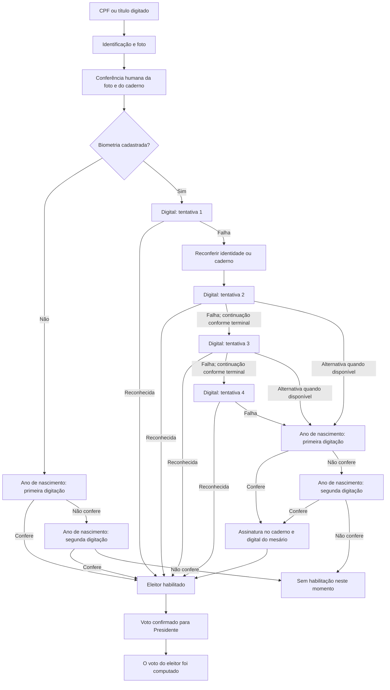

# Etapa 1 — mapa dos eventos de votação por percurso

**Urna piloto:** zona 0252, seção 0001, segundo turno de 25/10/2026. Esta é uma variação da análise da [assinatura repetida](https://github.com/JuniorNarciso26/conferencia-eleicao-26Br-/issues/20): em vez de buscar uma sequência escolhida de antemão, ela classifica **todos os 280 percursos concluídos** desta urna e conserva todos os eventos `VOTA` de cada percurso. Nenhum percurso é chamado de voto falso com base neste mapa.

## Mapa de decisão

As saídas para a alternativa após a segunda ou terceira leitura são **possibilidades normativas**, não funcionamento confirmado nesta versão da urna. A norma permite até quatro leituras e exige reconferência e nova tentativa após não reconhecimento. No exemplo oficial do log, a habilitação manual segue quatro tentativas. A conferência física da foto e do caderno, a assinatura e a presença da pessoa não são comprovadas pelo log.

## Correspondência com as mensagens do log

| Bloco | Mensagens que podem aparecer | O que registrar por percurso |
|---|---|---|
| Identificação | `Identificador do eleitor digitado pelo mesário`; tipo `(CPF)` ou `(Título de eleitor)`; `Foto do eleitor apresentada` | Tipo de identificador, ordem e segundos relativos; sem número pessoal |
| Biometria | `Solicita digital. Tentativa [n] de [4]`; `Capturada a digital...`; `Número de tentativas de reconhecimento do dedo...` ou `Timeout...` | Tentativas solicitadas e capturadas separadamente, timeout e resultado |
| Sem biometria | `Ano de nascimento digitado é igual ao do cadastro` | Conferência registrada; sem presumir que todas as parametrizações geram a mesma mensagem |
| Alternativa após falha biométrica | `Solicitação de dado pessoal do eleitor para habilitação manual`; `Dado digitado confere`; `Solicita digital do mesário`; `Mesário ... habilitou o eleitor` | Dado validado, intervenção do mesário e eventuais falhas |
| Conclusão | `Eleitor foi habilitado`; `Voto confirmado para [Presidente]`; `O voto do eleitor foi computado` | Presença, ordem e intervalo entre as três mensagens |

## Primeira aplicação ao log original

O pacote original foi reaberto; seu SHA-256 coincidiu com o manifesto local. Os 280 percursos reconstruídos anteriormente foram conferidos evento por evento contra as linhas do log original. Para cada percurso, o arquivo local `mapa_votos_0252_0001_2t.json` guarda a sequência de mensagens, a quantidade de tentativas solicitadas e o deslocamento em segundos desde o primeiro evento. Identificadores numéricos longos foram substituídos por `#`; horários absolutos não foram incluídos nesse arquivo.

| Caminho observado | Percursos | Tentativas de digital solicitadas |
|---|---:|---|
| Biometria reconhecida | 252 | 205 com 1; 28 com 2; 11 com 3; 8 com 4 |
| Biometria não reconhecida, seguida de habilitação pelo mesário | 8 | Todos com 4 |
| Sem biometria cadastrada, com ano de nascimento registrado | 20 | Nenhuma |
| **Total** | **280** | |

Nos 280 percursos, houve uma habilitação, uma confirmação presidencial e um evento de voto computado por percurso. O log da data contém 3.528 eventos `VOTA`: 2.923 foram associados a esses percursos e 605 ficaram fora deles. Os eventos externos incluem preparação/encerramento da urna, espera por identificador, registro de mesários, justificativas e tentativas de identificação que não viraram um percurso de votação concluído. Eles não podem ser descartados da reconstrução integral da operação.

**Achado específico para a pergunta sobre tentativas:** nesta urna, os oito caminhos de habilitação manual após biometria não reconhecida passaram pelas quatro solicitações de digital. Isso descreve o observado na seção 0001; não prova que o software exigia quatro em todas as situações ou urnas.

## Limites e próxima etapa

Este mapa cobre os percursos concluídos, com eventos técnicos intercalados preservados. Ainda é necessário classificar os 605 eventos externos, eventuais operações sem conclusão e os caminhos de erro, suspensão, justificativa e contingência. Comparar tempos somente após separar esses caminhos e registrar a versão do aplicativo. Uma repetição de sequência não demonstra voto sem eleitor; log, RDV e BU são registros do mesmo sistema e precisam de confronto com evidência independente quando disponível.

Fontes: [Resolução TSE nº 23.751/2026, arts. 133–135](https://www.tse.jus.br/legislacao/compilada/res/2026/resolucao-no-23-751-de-26-de-fevereiro-de-2026?texto=compilado); [especificação TSE dos logs de 2026](https://www.tse.jus.br/eleicoes/eleicoes-2026-content/arquivos/log-do-ecossistema).

